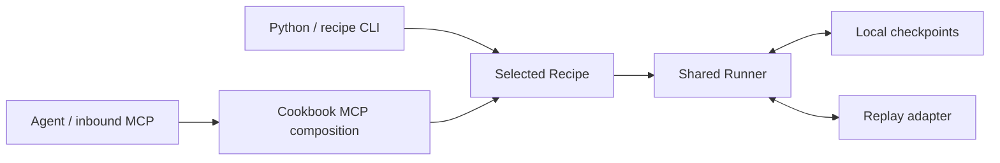

<p align="center">
  <a href="https://terac.com"></a>
</p>

<h1 align="center">Terac Cookbook</h1>

<p align="center"><strong>Expert feedback. Inspectable workflows. Agent-owned next steps.</strong></p>

<p align="center">
  <a href="#run-your-first-recipe">Run Oracle</a> ·
  <a href="#connect-your-local-agent">Connect an agent</a> ·
  <a href="#build-a-recipe">Contribute a recipe</a>
</p>

[Terac](https://terac.com) connects research teams, products and agents with
on-demand human experts through a dashboard, REST API and MCP. **Cookbook** is an
[MIT-licensed](LICENSE) collection of runnable, inspectable agent–expert workflows.
Contribute a recipe with its own inputs and useful outputs, reusing the shared
run mechanics and caller interfaces.

## How recipes fit together

Each **Recipe** owns its domain models, input/result meaning and validation.
The shared **Runner** manages run identity, lifecycle and saved checkpoints;
**adapters** supply execution events. Python and recipe CLIs call the Recipe
directly. Inbound MCP uses explicit application composition: a catalog advertises
registered recipe services, and recipe-owned tool bindings expose their actions.



New recipes add their own domain code and explicit caller registrations while
sharing the Runner. The [architecture](docs/architecture.md) explains the seams;
[Contributing](CONTRIBUTING.md) shows how to extend and test them together.
Replay is the supported execution path in this revision. Outbound Terac
MCP/REST fulfillment is planned separately; live provider operations need a
recipe-specific contract and adapter before they can be used.

## First recipe: Oracle

**Oracle** is the first shipped recipe and worked example: submit a go-to-market
brief, inspect scoped feedback, and decide what to do next. Its GTM models belong
to Oracle; other recipes define their own jobs and results. Try its complete
**synthetic replay** locally—no Terac account, API key or expert spend.


## Run your first recipe

Requires Python 3.11+, Git and [uv](https://docs.astral.sh/uv/).
Repository access is required to clone this checkout.

```sh
git clone https://github.com/TeracAI/terac-cookbook.git
cd terac-cookbook
uv sync --locked
uv run --no-sync terac-oracle start --brief "Synthetic repair-shop appointment tool: demand and pricing are unproven."
```

Copy the returned `run_id` and replace `RUN_ID` below. Keep the same checkout and
state directory; the CLI default is `.tmp/oracle`.

```sh
uv run --no-sync terac-oracle inspect RUN_ID
uv run --no-sync terac-oracle resume RUN_ID
uv run --no-sync terac-oracle respond RUN_ID --answer "Independent repair shops; willingness to pay is untested."
uv run --no-sync terac-oracle resume RUN_ID
uv run --no-sync terac-oracle inspect RUN_ID
```

The first inspection remains waiting. The first resume exposes a scripted
clarification; respond saves an answer without advancing work. The next resume
delivers synthetic inconclusive feedback. Separate commands can run after a
process exit: retain the run ID and the same compatible state directory.

Replay demonstrates software behavior, not an expert assessment of the supplied
brief. A `succeeded` run means validated feedback was delivered; Oracle's
recommendation may still be pass, fail or inconclusive. Explain the evidence and
limitations rather than treating workflow completion as business approval.

## Explore outcomes and fresh linked work

Start a separate synthetic case with `--replay-case pass_with_comments` or
`--replay-case fail`; each delivers on its first resume. Omitting the selector
uses the clarification/inconclusive case above. These cases are scripted, not
different price tiers or live expert opinions.

For a fresh offline follow-up, reuse a delivered run as the parent:

```sh
uv run --no-sync terac-oracle start --brief "Revised synthetic buyer hypothesis; no paid commitments." --parent-id RUN_ID --intent follow_up
```

This creates another run and preserves the earlier review. Revised text has no
inherited verdict. The [Oracle guide](docs/recipes/oracle.md) covers the exact
input/result contract, errors, linked new queries and restart compatibility.

## Connect your local agent

Add the MCP dependencies to this reviewed checkout:

```sh
uv sync --locked --extra connectors
```

Configure your MCP host using the command/argument contract in the
[local MCP guide](docs/mcp.md), with an absolute private state directory. The
Cookbook server uses stdio, not a hosted HTTP endpoint. Installing dependencies
does not configure a client or establish named-client support.

Call `cookbook_list_recipes`, inspect the selected recipe's actual tool schemas,
then use its supported actions. Oracle currently exposes `oracle_start`,
`oracle_inspect`, `oracle_respond` and `oracle_resume`. There is no assumed
universal recipe-start tool or executable YAML dispatcher.

The [Cookbook agent skill](.agents/skills/terac-cookbook/SKILL.md) routes discovery
and shared workflow to recipe-local guidance. It is checkout guidance, not a
claim that every package installation or MCP host installs skills automatically.

## Build a recipe

Propose a concrete input, useful output, waiting/failure cases and offline
demonstration. The proposal YAML collects an idea; Python implements it.
Keep domain models in the recipe, run mechanics in the runner and transport in
adapters. Register the intended Python/CLI/MCP surfaces explicitly and prove
restart, artifact binding and isolation from existing recipes. Oracle is the
first recipe, not a universal schema for every expert workflow.

Start with [Contributing](CONTRIBUTING.md) and the
[recipe-creation skill](.agents/skills/recipe-creation/SKILL.md), which links the
implementation, registration points and caller tests. Use the contribution
guide's offline checks and review path before a pull request.
Passing local tests, hosted CI and enforced merge checks are separate evidence.
Do not include credentials, private checkpoints or uncleared expert material.

## Explore the docs

- [Documentation home](docs/index.md) and [recipe catalog](docs/recipes/index.md)
  — choose an example and its supported modes.
- [Oracle guide](docs/recipes/oracle.md) — inputs, feedback, Python/CLI calls and
  saved-run recovery.
- [Architecture](docs/architecture.md) — recipes, runner, adapters and state.
- [Local MCP](docs/mcp.md) — discovery, process setup and caller semantics.
- [Read-only Terac diagnostics](docs/terac-access.md) — check access independently
  of a Recipe Run; study creation and launch are not supported in this revision.

The generated HTML reading views under `docs/` offer the same guides with local
navigation and diagrams. Markdown is the canonical source.

## Supported today

This baseline provides local Python, CLI and stdio MCP replay. Live expert
fulfillment remains unavailable; read-only diagnostics do not enable it.
Terac's hosted MCP/REST connector is a different interface from this Cookbook
server. Actual expert reports need verified retrieval, binding and provenance;
status alone is not feedback. Advice grants no authority to recruit, spend or pay.

Checkpoints are local plaintext JSON with one owning process at a time. There
are no automatic agent wakeups or concurrent-writer guarantees. Preserve
incompatible saved work rather than editing it to force a reload.

Install/update from a reviewed Git revision and its lockfile; these instructions
make no PyPI-publication claim. This packet's base checkout declares
`0.2.0.dev1` in [package metadata](pyproject.toml), not a published stable release.
See [update and recovery](docs/recipes/oracle.md#restart-and-updates)
before moving an existing run to a new version. Original code is under the
[MIT license](LICENSE); third-party notices and rights to actual expert material
remain separate.
