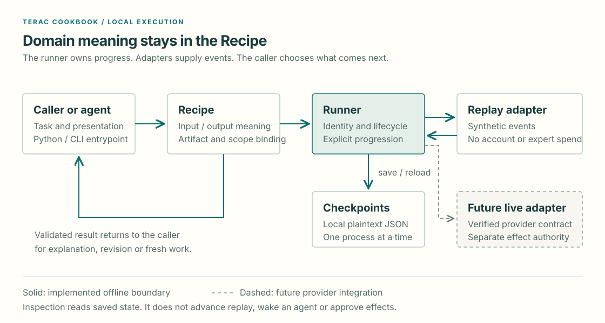

# Architecture

A Recipe defines the job. The runner makes its progress inspectable. Adapters
supply events without taking over the Recipe's meaning.

Terac Cookbook is a local Python package. The offline baseline implements one
Recipe, [Oracle](recipes/oracle.md), through Python and the `terac-oracle` CLI.
Replay uses synthetic events without accounts, network calls or expert spend.
An optional [local MCP adapter](mcp.md) exposes that same caller interface.

## Keep the responsibilities clear

| Component | Owns |
|---|---|
| Calling agent | Task context, presentation, revision and the next request |
| Recipe | Domain input/output meaning, exact artifact binding and result validation |
| Runner | Run identity, lifecycle and explicit progression |
| Checkpoint storage | Saved local state and validated reload |
| Replay adapter | Synthetic events and controlled scheduling |
| Future provider adapter | Authentication, transport, provider identities and verified work-content mapping |

The runner does not interpret GTM feedback. Oracle does not own transport or
rewrite the brief. An adapter does not decide whether a review passes.

New recipes are explicit Python implementations with documented entrypoints.
There is no generic recipe dispatcher or YAML execution language in this baseline.
A second working Recipe can justify additional shared behavior.

## Four actions, explicit progress

| Action | Caller-visible behavior |
|---|---|
| `start` | Bind an exact input to a new run and save its initial waiting state |
| `inspect` | Read waiting, clarification, feedback or failure without advancing |
| `respond` | Save an answer to the current clarification without releasing another event |
| `resume` | Reattach and release at most one replay event; paused or terminal work returns saved state |

Linked work is another `start`, carrying `parent_id` and an explicit `follow_up`
or `new_query` intent. It creates fresh work, preserves the parent and does not
inherit the parent's recommendation. These are still four caller actions.

The caller retains its run identifier and chooses when to reattach. Saving a
checkpoint does not wake an agent or schedule a worker.

## State is different from a recommendation

Run status describes workflow delivery. Phase describes current work. The Recipe
defines the meaning of its result.

For Oracle, a `succeeded` run means validated feedback was delivered. That review
can recommend `pass`, `fail` or `inconclusive`. Malformed feedback or a wrong
artifact/scope binding causes workflow failure rather than becoming a review.

Keep these facts separate: run completion, expert delivery, recommendation,
caller revision, and provider labor/payment state. A changed artifact has no
inherited verdict. Feedback grants no authority for further effects.

## Replay, restart and compatibility

Each run pins its replay case, checkpoint/recipe/fixture versions and a semantic
fixture digest. A linked lineage validates each ancestor against its own pin.
Whitespace and JSON object-key order do not change fixture identity; changed
events, cases or versions do.

Restart uses the same state directory and run identifier. Reload checks identity,
scope, lifecycle, replay position and lineage before returning state. Legacy,
unsupported or altered checkpoints return `checkpoint_incompatible` without
rewriting or silently migrating saved bytes.

Storage uses atomic replacement of local plaintext JSON and supports one process
at a time. Concurrent writers, encryption, expiry, automatic retries, cancellation,
deadlines and production recovery are outside the current guarantees.

## Transport and provider boundaries

**Inbound** means a caller invokes Cookbook. **Outbound** means Cookbook invokes
a provider such as Terac. These directions have distinct authentication and
deployment responsibilities.

The baseline exposes inbound Python, CLI and optional local-stdio MCP calls,
with replay as its only runner adapter. Live selection is rejected. Credentials
alone never select live operation or establish content compatibility.

The MCP process owns protocol schemas, bounded error responses and serialization
within one process. It exposes `cookbook_list_recipes` and `oracle_start`,
`oracle_inspect`, `oracle_respond`, `oracle_resume`. It calls Oracle's existing
methods; it adds no second execution model. Discovery reports Oracle and replay
availability without reading or advancing runs.

Inbound Cookbook MCP is separate from outbound Terac MCP/REST and the provider's
hosted connector. This process makes no provider requests and reads no provider
credentials. SDK stdio checks do not establish acceptance inside a named client
application. See the [MCP contract](mcp.md) for response formats and launch limits.

A future live adapter needs an agreed caller contract and observed evidence for
submission, progress, clarification, substantive delivery, errors and uncertain
writes. A provider status or successful login does not establish a delivered
review. Reconcile an uncertain submission before retrying effects.

Disclosure, recruitment, spend, follow-up, payment, rejection and publication each
require declared authority. Replay fixtures and published responses also need
rights and privacy clearance for their exact version and audience.

## Read-only context is a separate diagnostic

The optional Python context reader performs one bounded REST read and discards
provider values after shape validation. Windows operator scripts own encrypted
local key storage and a narrow context/catalog probe. Neither is an Oracle live
runner adapter: no provider task IDs, expert request, substantive delivery or
continuation are introduced. See [Terac access](terac-access.md).

## Extend the smallest useful seam

Agree the new Recipe's inputs, outputs, permitted effects and failure cases
before runtime code. Demonstrate them through the caller interface with fake
providers and synthetic fixtures. Include packaged assets and verify installation
outside the checkout. See [Contributing](../CONTRIBUTING.md).

These boundaries support local, inspectable examples. Hosted execution, a shared
database and generic orchestration are separate design decisions that need a
concrete workflow and acceptance evidence.
