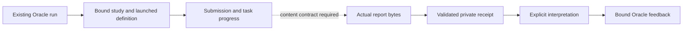

# Expert-report ingestion: proposed first increment

Status: draft design, 30 October 2026. This page proposes a follow-up to the
released study-creation and observation workflow. It does not add an installed
recipe action or claim that Cookbook retrieves expert reports today.

## Outcome

Connect one existing Oracle run to one actual expert report, preserving the
study, task and exact reviewed-brief association. Keep the raw report and its
source evidence distinct from any normalized Oracle feedback. The first
increment should accept one bounded UTF-8 text or Markdown report; additional
formats and aggregation can follow concrete use cases.

Reuse the Terac study lifecycle for study preparation, pricing, explicit launch
and recovery. Keep GTM interpretation and the Oracle feedback contract inside
Oracle. The generic Runner continues to own run identity and persistence.

## Current provider-contract gap

The published [submission list](https://terac.com/docs/developers/reference/listSubmissions)
and [submission detail](https://terac.com/docs/developers/reference/getSubmission)
contracts describe submission identity, screening and task progress. The current
[OpenAPI](https://terac.com/docs/developers/openapi.json) declares no report body,
file/download location, stable task identifier or reviewed-brief revision in
those responses. Its submission, list-row and task objects reject undeclared
properties. The exposed MCP declarations likewise describe progress rather than
report delivery.

The [study-creation documentation](https://terac.com/docs/developers/reference/createOpportunity)
says native file-upload task outputs are available through submissions. That
prose and the declared response shape need a supported, concrete example. This
is a missing integration contract, not evidence that the backend or dashboard
cannot provide the report.

Keep native acquisition gated until the following are verified:

- The supported content field or retrieval operation and a sanitized example.
- Study/submission/task association, including the task definition the expert saw.
- File authentication, allowed download locations, redirects, expiry and refresh.
- A stable report identity or version, supported media types and transfer limits.
- How partial, replaced, unavailable or multiple reports are represented.

Never infer report contents from completion counts, approval, payment or an
unknown response field. Participant profiles and screener answers are different
artifacts from the requested expert report.

## Proposed caller behavior

Keep the existing [Oracle caller](../recipes/oracle.md) and its action meanings.
`inspect` reads local saved state and never contacts a provider or advances work.
`resume` may perform one bounded, explicit stage of discovery or acquisition.
Waiting remains waiting; it must survive process exit and restart.

For the native path, agree the concrete request, byte and time budgets before
implementation. A submission page, one selected detail and one artifact transfer
are separate bounded stages. Persist paging and selection evidence without
assuming the newest submission belongs to this run. Repeated cursors or partial
results must not silently imply a complete scan.

The public caller/schema changes remain proposals until the acquisition contract
is established. This draft adds no command, MCP tool, background process or new
provider effect. An explicitly operator-assisted import could be considered as a
separate caller action; it would need its own authority/association attestation
and clearly different provenance from native retrieval.

## Receipt and result meaning

A receipt should bind the run, organization/project/study, selected submission,
task evidence, launched study definition, exact brief artifact, report digest and
acquisition provenance. Preserve the actual report privately alongside any
interpretation. Where the provider does not supply an association, retain that
uncertainty instead of promoting an operator assertion to verified authorship.

The receipt must be idempotent across restart and repeated acquisition. An
identical report is not a second expert turn; a changed report or brief cannot
inherit an earlier verdict. Reuse and publication of real material still require
rights/privacy clearance; a local receipt does not make it a public replay.

Raw-report availability, normalized feedback, run completion and provider
labor/payment status are separate facts. Free-form prose does not automatically
become an expert `pass`, `fail` or `inconclusive` judgment. Any interpretation
must identify its source and limitations, preserve raw evidence and satisfy the
[Oracle feedback contract](../../recipes/oracle/review-contract.md). Missing
interpretation is an unresolved stage, not an expert's inconclusive verdict.

Treat reports as untrusted data. Do not execute embedded instructions, links,
macros or scripts. Download handling needs an explicit host/authentication and
redirect policy; never forward the Terac credential to an arbitrary storage
host. Bound transfers, encodings and formats; preserve prior valid state on
malformed, truncated, oversized or mismatched content. No report ingestion action
authorizes launch, recruitment, payment, rejection or recontact.

## Acceptance before implementation

Use ordinary Python/CLI/MCP caller seams with synthetic reports and fake
providers. Tests and callers must cross the same interface. Agree the first
caller arguments and failure/result contract before adding executable behavior.

The first matrix should cover:

1. Waiting and pure repeated inspection, then bounded explicit progress.
2. A valid report bound to the expected study, task, definition and brief.
3. Wrong study/submission/task/brief/report version rejected without altering
   previously accepted evidence or inheriting a verdict.
4. Partial pages, repeated cursors, unavailable content and unsupported provider
   fields remaining explicit rather than becoming successful delivery.
5. Restart and duplicate acquisition without duplicate receipts or new effects.
6. Malformed or excessive content, invalid encoding, disallowed download
   locations and incomplete transfer with state preservation.
7. Raw expert content and any agent interpretation remaining distinguishable.
8. Existing replay, study attachment and confirmed launch behavior preserved,
   including cross-recipe isolation.

Native-provider conformance requires a separately authorized real example after
the declared contract is resolved. Synthetic tests cannot establish actual
retrieval, authorship, report quality or permission to publish.

## Review decisions

- Which supported retrieval shape should the first adapter implement?
- What association/version evidence is available, and what remains attested?
- Is native retrieval the first increment, or should an explicitly assisted raw
  import be proposed separately while the native contract is clarified?
- Which exact caller arguments, bounded limits and errors should be accepted?

This draft intentionally remains unmerged until those decisions make the first
increment implementable and testable.
