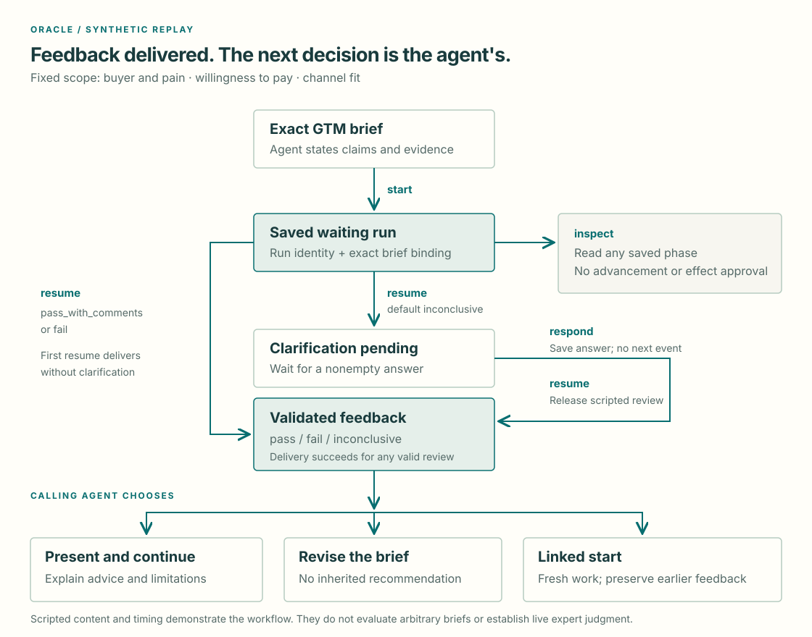

# Oracle

**Turn a go-to-market brief into a clear next decision.** Oracle returns scoped
review feedback; the calling agent decides whether to explain it, revise the
brief, continue the task or request linked work.

The implemented example is a fictional appointment tool for independent repair
shops. Its replay is synthetic and scripted. It needs no account, network call
or expert spend. Live expert fulfillment is unavailable.



## Input, scope and result

Pass a nonempty brief to `start`. The fixed review scope is **buyer and pain**,
**willingness to pay**, and **channel fit**. State which claims are supported,
which remain hypotheses and what evidence is available.

Every snapshot returns `run_id`, `parent_id`, `intent`, `artifact_id`, `brief`,
`scope`, `mode`, `replay_case`, `status`, `phase`, `question`, `feedback` and
`error`. The exact brief text determines its artifact identity; each execution
has a distinct run identity.

Feedback carries the reviewed identity/scope, recommendation, rationale, material
findings, advisory comments, limitations, next steps and synthetic provenance.
The [feedback contract](../../recipes/oracle/review-contract.md) defines its
fields and interpretation.

## Run the default case

From a checkout installed with `uv sync --locked`, run:

```sh
uv run --no-sync terac-oracle start --brief "Synthetic repair-shop appointment tool: demand and pricing are unproven."
```

Copy the returned `run_id` and replace `RUN_ID` below. The CLI stores state in
`.tmp/oracle` by default. Keep that directory consistent across commands.

```sh
uv run --no-sync terac-oracle inspect RUN_ID
uv run --no-sync terac-oracle resume RUN_ID
uv run --no-sync terac-oracle inspect RUN_ID
uv run --no-sync terac-oracle respond RUN_ID --answer "Independent repair shops"
uv run --no-sync terac-oracle resume RUN_ID
uv run --no-sync terac-oracle inspect RUN_ID
```

Expected sequence:

1. `start` saves `working / waiting_for_expert`.
2. `inspect` returns that state unchanged.
3. First `resume` exposes `needs_input / awaiting_clarification` and a question.
4. `respond` records the answer and returns to waiting without advancing replay.
5. Next `resume` delivers `succeeded / feedback_available`, with an
   `inconclusive` recommendation.
6. `inspect` reads delivered feedback unchanged. Terminal `resume` also returns
   the saved result.

Replay does not simulate elapsed expert time. Its review does not adapt to the
brief or answer. An unanswered clarification keeps the run paused.

## Select another outcome

| `replay_case` | Schedule and feedback |
|---|---|
| `inconclusive` | Default; clarification, answer, then feedback describing insufficient evidence |
| `pass_with_comments` | First resume delivers `pass`, with advisory comments and no material findings |
| `fail` | First resume delivers a material finding: a claim of 20 paying pilot customers conflicts with 20 free trials and zero paid commitments |

Select the case when starting; the run retains it after restart:

```sh
uv run --no-sync terac-oracle start --brief "Synthetic channel hypothesis for independent repair shops." --replay-case pass_with_comments
uv run --no-sync terac-oracle start --brief "Synthetic claim: 20 paying pilot customers. Evidence: 20 free trials and zero paid commitments." --replay-case fail
```

Resume each returned run once to receive its scripted review. Omitting
`replay_case` in Python, or passing `None`, selects `inconclusive`.

## Use the same interface from Python

```python
from pathlib import Path

from recipes.oracle import Oracle

oracle = Oracle(Path(".tmp/oracle"))
started = oracle.start("Synthetic repair-shop appointment tool.")
waiting = oracle.inspect(started.run_id)
question = oracle.resume(started.run_id)
oracle.respond(started.run_id, "Independent repair shops")
delivered = oracle.resume(started.run_id)
print(delivered.feedback.recommendation)
```

Python and CLI use the same four actions. `inspect` reads without advancement;
`respond` saves an answer; `resume` releases at most one event.

## Call from a local MCP client

The optional [Cookbook MCP process](../mcp.md) exposes discovery plus
`oracle_start`, `oracle_inspect`, `oracle_respond` and `oracle_resume`. These call
the same Oracle interface and retain replay, exact-brief binding and explicit
resumption. Configure one local process with an absolute state-directory path.
Application-client acceptance remains unverified; follow the MCP guide's launch
and response contract rather than assuming a client-specific configuration.

## Decide what comes next

A `succeeded` run records delivery of valid feedback. A valid `fail` or
`inconclusive` review can complete delivery successfully. Neither completion nor
the recommendation determines provider labor approval or payment.

The calling agent may present the result, apply or decline advice, revise the
brief or continue without another Oracle request. Explain changes relative to
the reviewed text. A revised brief has a new identity and no inherited verdict.

To request fresh linked work, use `start` with the earlier `run_id` as parent
and an explicit intent:

```sh
uv run --no-sync terac-oracle start --brief "Synthetic follow-up: investigate the channel hypothesis." --parent-id RUN_ID --intent follow_up --replay-case pass_with_comments
```

Use `new_query` for a new linked question. Linked work creates its own run and
starts without feedback; it preserves the parent and can select its own case.
It is a use of `start`, not a fifth action. `respond` answers a currently pending
clarification; linked `start` opens new work. No real-expert continuity is implied.

## Restart and updates

Exit and later use the same run ID and state directory. To choose a different
state directory, place `--state-dir PATH` before the action on every invocation:

```sh
uv run --no-sync terac-oracle --state-dir .tmp/my-oracle inspect RUN_ID
```

Each checkpoint pins its case, checkpoint/recipe/fixture versions and semantic
fixture digest. Every linked ancestor uses its own saved pin. Unsupported,
legacy or changed pins return `checkpoint_incompatible` without rewriting saved
state. There is no automatic migration.

To update a clean checkout, select the reviewed revision deliberately, then run
`uv sync --locked`. Updating source and upgrading dependencies are different
operations. Preserve private checkpoints separately; do not assume an update can
resume incompatible state.

Local storage is plaintext JSON with atomic replacement, for one process at a
time. It is not a daemon or shared database. No background wakeups, deadlines,
cancellation, automatic retries or concurrent recovery are implemented.

## Errors and effects

Empty briefs or answers, a response without a pending question, invalid parent
intent and unknown runs are rejected. Unknown cases return `invalid_replay_case`;
a known case unavailable to an injected replay adapter returns
`replay_case_unavailable`. Invalid checkpoints return `checkpoint_incompatible`.
The CLI reports these runtime rejections as a JSON error and exits with status 2.

Schema validation and exact artifact/scope binding precede feedback delivery.
Malformed or mismatched events cause workflow failure. A material finding cannot
accompany `pass`.

Replay stays default regardless of credentials; `--mode live` is rejected as
`live_unavailable`. Disclosure, recruitment, spend, follow-up, payment, rejection
and publication require declared authority. Feedback cannot grant it. Do not
commit local checkpoints, private briefs or confidential responses.

[Architecture](../architecture.md) explains shared state and adapter boundaries.
[Contributing](../../CONTRIBUTING.md) describes offline testing and new Recipes.
